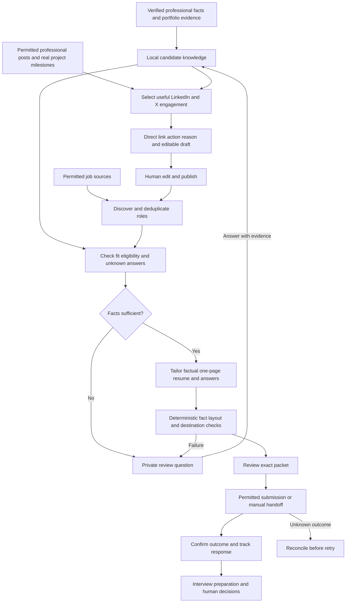

# Local Career Agent

An experimental, locally hosted career assistant: job research and truthful
application drafts, paired with useful participation on LinkedIn and X.
Built around OpenClaw, a local LLM and rootless Docker on a consumer GPU PC.

**Current stage: reproducible setup materials and a tested local integration.**
This is a work in progress, not a finished autonomous job applicant. The model
failed a factual check, and restart recovery resumed an interrupted task.
Those failures are documented here because they determine what we build next.

## Why this exists

Finding suitable jobs, maintaining application context, tailoring a concise resume
and staying active in professional conversations involve repeated work. The goal
is to reduce that work while retaining accurate personal representation and control
over what is sent. More applications alone is not the success metric.

The planned social workflow goes beyond job advertisements: identify worthwhile
posts, recommend a specific action with a direct link, and draft a useful comment,
reshare or original post in the person's voice. The current package has no social
account access or publishing integration.

## What works today

| Component | Observed status |
|---|---|
| LM Studio headless + Qwen3.5-9B Q4_K_M | Loaded on an RTX 3060 12 GB; local API checks passed |
| OpenClaw 2026.11.3 | Connected to the local model; read/write tool calls completed |
| Rootless Docker 29.9.3 | Tool sandbox ran with no network, read-only root and resource limits |
| Workspace restriction | Attempted outside-workspace file read was blocked |
| Dedicated operator browser | Public page navigation and text snapshot worked; agent browser tool stays denied |
| Security audit | 0 critical, 1 warning at the recorded checkpoint; not a security guarantee |
| Answer correctness | Mixed: a simple task passed, but a fresh gateway task omitted a missing skill |
| Output validation | Deterministic v1 skill-match gate rejects the recorded failures; requires explicit invocation |
| Restart behavior | Interrupted task resumed and overwrote a test output; unresolved workflow risk |

No Gmail, employer portal, LinkedIn or X accounts are connected. No unattended
startup service is included. Services were stopped after the recorded tests.

## The intended flow



This diagram is the target design. The installed baseline currently provides local
inference and constrained file tools; the queue, renderer, submission controller,
account integrations and social planner are still to be built.

## Start here

1. Read [setup and exact commands](docs/setup.md). Target: x86_64 Omarchy/Arch,
   approximately 12 GB NVIDIA VRAM and 16 GB RAM. Installers refuse root and other
   inference-host platforms. Do not run them on your Mac.
2. Inspect the scripts and pinned artifacts. Start with the inference preflight:

   ```bash
   python3 inference/setup_pc.py
   ```

3. Follow the runbook to install explicitly, generate a private configuration,
   build the tool image and start visible foreground sessions. Each stage is
   separate so failures can be inspected without opening account access.
4. Run synthetic checks and inspect their actual outputs before using private data.

New portable packaging helpers have local tests/syntax checks. A second clean-PC
installation of this complete repository has **not** been executed. The original
hardware results came from the recorded staged setup, not a fresh one-command installer.

## Repository map

- [Architecture and trust boundaries](docs/architecture.md)
- [Observed findings, including failures](docs/findings.md)
- [Output validation and CLI contract](docs/output-validation.md)
- [Security and privacy](SECURITY.md)
- [Model requirements and benchmark plan](docs/models.md)
- [Next increments](docs/roadmap.md)
- [Detailed workflow diagrams and edge cases](docs/design/README.md)
- [Dated research and reuse audit](docs/research/README.md)
- `inference/`: original tested inference bootstrap, model hashes and regression tests
- `scripts/`: install/preparation helpers, portable config generator and guarded launchers
- `config/`: public template and workspace rules; actual token is generated locally
- `examples/results/`: selected sanitized synthetic evidence, including failed outputs

## Development checks

```bash
python3 -m unittest discover -s inference -p 'test_*.py'
python3 -m unittest discover -s tests -p 'test_*.py'
for script in scripts/*.sh; do bash -n "$script"; done
```

Tests use only synthetic data. Some inference transport tests use a loopback HTTP
server; none require a GPU, model download or real account.

## Operating principles

- Evidence-backed skills and answers; unknowns go to review.
- Readable, truthful resumes. No hidden qualification stuffing or fabricated claims.
- Separate local drafting from account authority and outbound disclosure.
- No stealth automation, CAPTCHA bypass or concealed assessment answering.
- Prefer permitted access routes and reviewed publication. Check current platform
  terms before adding an integration; this repository grants no platform permission.
- A localhost endpoint is not an outbound firewall. Downloads and web activity
  contact third parties; job applications necessarily disclose approved data.
- A local model remains an unreliable component until task-specific evaluation says otherwise.

Contributions and iteration are welcome; see [CONTRIBUTING.md](CONTRIBUTING.md).
The project's original code/docs use the [MIT license](LICENSE). External models,
OpenClaw, Docker, LM Studio and referenced projects retain their own licenses and terms.
