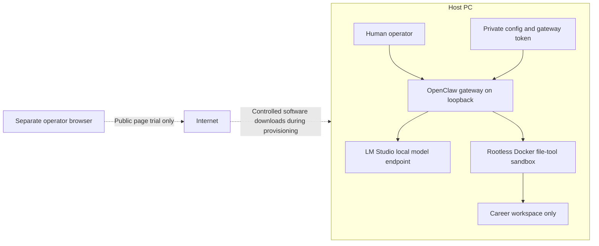

# Architecture and operating flow

The baseline is intentionally small: OpenClaw calls a local text model and may
read/write a dedicated workspace through restricted tools. The full system below
is a design, not a list of installed features.

The gateway and inference runtime live outside the tool sandbox. No host-wide
egress firewall was tested. The model is denied browser, web, shell and messaging
tools. The operator browser test is separate from model access.

## Proposed full workflow

1. Build a verified professional dossier: actual skills and proficiency, dated
   experience, project ownership, public demos, supported metrics and approved
   scoped answers. Separate learning from professional experience.
2. Read permitted role sources, validate employer/source/freshness, deduplicate
   roles and assess actual eligibility. Keep source text untrusted.
3. Generate a factual application packet from evidence. Render a readable one-page
   PDF using a fixed template; validate page count, links and supported claims.
4. Queue missing/ambiguous answers. Present the exact destination, answers,
   attachments and disclosure to the human before any live-page field entry.
5. Use a narrow permitted submission worker or manual handoff. Persist intent and
   result. An unclear outcome becomes outcome-unknown, not automatic retry.
6. Match receipts and recruiter responses, prepare interview practice, and compare
   offers. Negotiation, acceptance, resignation and independent assessments remain
   human decisions/actions.
7. In parallel, turn real portfolio work and useful professional conversations
   into engagement recommendations. Each card includes channel, source/post link,
   action, reason, draft, context and expiry. Humans edit and publish.

## Persistent state and approval

Use one ledger and one scheduler owner. OpenClaw is the current runtime choice;
n8n could later own events/approval waits if it removes real custom work. Do not
let both independently dispatch the same external action.

Every run needs a unique ID and immutable output paths. Every outbound action
needs an exact payload/destination hash, a valid approval and a recorded attempt.
Changed data invalidates approval. Persisted approvals must expire and be revoked
after restore or security incidents. Browser sessions must not provide a bypass
around the disclosure controller.

These mechanisms are not yet implemented by this repository. See detailed
[design diagrams](design/README.md), [exceptions](design/exceptions.md) and
[measured findings](findings.md).
