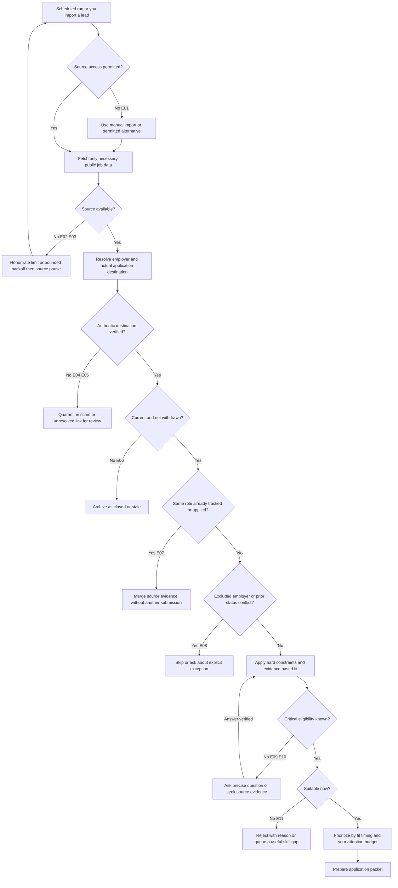
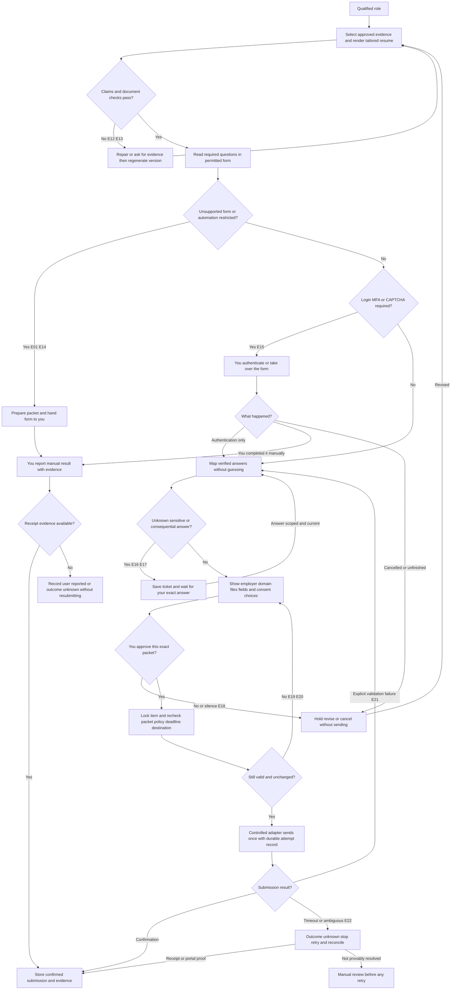

> Proposed workflow, not a deployed feature or completed security assessment. See [current findings](../findings.md) for what the installed baseline actually did.

# Opportunities and applications

Up: [Start here](../architecture.md). Exceptions: [E01–E40 handling](exceptions.md).

## Discovery and qualification

Remote does not automatically mean worldwide. Distinguish work country, timezone, employment type, sponsorship, relocation, and required attendance. Normalize salary currency, annual/monthly basis, gross/net ambiguity, fixed/variable components, and missing ranges before comparing. Unknown compensation need not reject a role if your policy allows review; do not invent a range.

Deduplicate using employer/requisition identity plus canonical posting, not just title. A referral arriving after application updates the existing record; ask about the employer's referral process rather than submitting again. Different roles at one employer may be distinct but still trigger an employer-level application policy.

## Prepare, review, submit, confirm

Manual completion does not become confirmed simply because you opened the form. If you cannot provide evidence, record user-reported submission or outcome-unknown separately from machine-confirmed submission.

Approval must bind job ID, employer/destination, packet version/hash, file contents, outgoing fields, action, and expiry. If any changes, ask again. A browser may transmit typed fields before its Submit button is clicked; stage personal answers locally and approve disclosure before the controlled worker fills the live form. Preview uploads, pre-submit autosaves, and application tracking scripts are part of the approved destination's data exposure.

The model cannot hold unrestricted browser/shell/network access that bypasses this controller. A domain allowlist alone cannot prevent leaking data to an unintended recipient at an allowed site. The controller validates action, role, form endpoint, recipient, payload, redirects, and permitted attachments too. Employer third-party hosts must be included in the review; a changed host stops the action.

Use durable attempts, a local uniqueness constraint/lock, and receipt reconciliation. These reduce duplicates but cannot guarantee exactly-once submission on a website without server-side idempotency. Never silently retry a timed-out external write. Explicit field-validation errors allow repair, but changes still invalidate the old packet approval.

## Follow-up and progression

After confirmed submission, keep the packet and receipt, review selected recruiter messages locally, and set a reasonable review date. Draft a relevant follow-up for you if useful; do not auto-send repeated outreach. No response remains no-response until evidence changes it. See [interview and offer flow](interviews.md).

A future auto-submit policy is not active in this design. It would need explicit authorization for a narrow employer/source set, approved facts and consent rules, tested adapters, caps, and exception handling. Identity documents, legal declarations, unfamiliar terms, assessments, or failed checks still require you.
