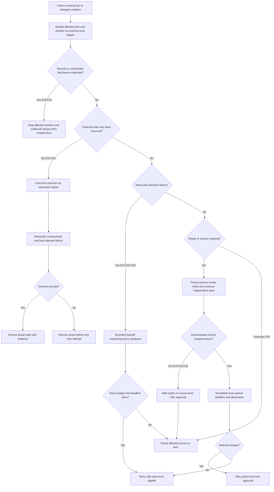
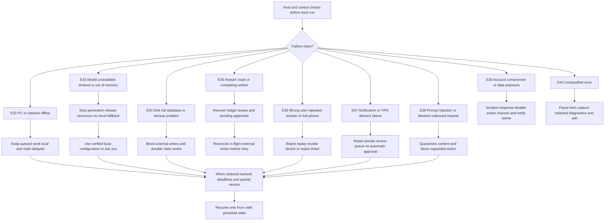

> Proposed workflow, not a deployed feature or completed security assessment. See [current findings](../findings.md) for what the installed baseline actually did.

# Exceptions and recovery

Up: [Start here](../architecture.md). Each ID below is referenced by a diagram or diagram node. This is a register of foreseeable cases, with a fail-closed route for unknown failures, not a claim that all possible future failures are known.

## Every action uses this exception route

All external-action failures have priority over generic retry logic. A read-only request may still disclose a query; retries use the same minimal permitted inputs. Backoff does not bypass access restrictions. While one item waits, only independent work that does not depend on its answer may proceed.

## Host, phone, and security failure paths

## Edge-case register

| ID | Trigger | Required handling and resume condition |
| --- | --- | --- |
| E01 | Restricted source, platform policy, or unauthorized automation | Use a permitted feed/API or manual import. Hand off restricted forms. No scraping workaround, credential reuse, or CAPTCHA bypass. |
| E02 | Rate limit or temporary block | Respect retry guidance, bounded backoff, then source pause. Do not rotate accounts/proxies to evade limits. |
| E03 | Source down, missing content, or malformed data | Preserve last-known record with stale label. Do not call an unseen role verified. Resume after a valid source read. |
| E04 | Scam, spoofed employer/recruiter, fee request, suspicious attachment | Quarantine; check official employer identity/domain. Do not send ID, payment, or credentials. You verify unresolved cases. |
| E05 | Redirect, domain change, or new upload recipient | Stop before private fields/files are sent. Resolve actual recipient and third-party processors; new approval for changed disclosure. |
| E06 | Closed, withdrawn, expired, reposted, or stale opening | Archive/mark uncertain. Reverify before application; map reposts to existing requisitions when evidence supports it. |
| E07 | Same role from several sources, referral after applying, duplicate run | Merge evidence; enforce per-role lock and attempt history. Referral updates existing record. Never send a second application just because a new URL appears. |
| E08 | Current employer, blocked company, prior rejection, or company-level limit | Apply your exclusion/reapplication policy. Ask only about a real exception; do not ignore it for a high fit score. |
| E09 | Remote-country, sponsorship, salary units, timezone, or contract status unclear | Seek source evidence or your answer. Unknown is not eligible or ineligible. Use an explicit watch state if uncertainty is acceptable. |
| E10 | Candidate facts conflict or become stale | Ask which fact is current; version the profile. Invalidate affected packets and answers, rather than updating old submissions retrospectively. |
| E11 | Material skill gap or role mismatch | Reject with evidence or flag a worthwhile portfolio gap. Do not rewrite the resume to imply qualifications you do not have. |
| E12 | Unsupported claim, invented citation, wrong dates/metrics, or inconsistent outputs | Stop packet/draft; compare with source evidence and repair. Repeated failures disqualify model/configuration from that task. |
| E13 | Resume render/text extraction, link, layout, or upload format fails | Repair the fixed template or use accepted format. Inspect visible document and extracted text before a new approval. |
| E14 | New/changed form, hidden required fields, unsupported widget | Stop adapter. Provide manual packet; do not let the model improvise unrestricted browser actions around the controller. |
| E15 | Login expiry, MFA, OTP, CAPTCHA, identity check | You authenticate directly in the intended session or complete the form. Do not put passwords/OTP into prompts. Resume only after session and packet revalidation. |
| E16 | Required personal answer absent or wording changes meaning | Save an item-scoped question. Reuse only approved, current answers with matching meaning and jurisdiction. |
| E17 | Demographics, legal consent, attestation, identity documents, salary commitments | You decide. No inference of protected traits or automatic acceptance of unfamiliar terms. Staging/filling is itself disclosure and needs the right authorization. |
| E18 | No response, explicit denial, skipped draft, or cancelled application | Leave held or cancel. Silence never grants permission. Unanswered routine questions remain queued without notification spam. |
| E19 | Approval expired, packet edited, session changed, or stale phone button | Reject the approval. Re-preview the new action/version and request a fresh decision. |
| E20 | Deadline passes or role changes after approval | Recheck actual status. If expired, archive; if material changes, new packet and approval. Never rush an unreviewed submission to beat a deadline. |
| E21 | Explicit form validation failure | Preserve field-level error; repair and revalidate. Changed outgoing content requires fresh approval. |
| E22 | Submit timeout, browser crash, missing receipt, ambiguous server response | Mark outcome-unknown. Reconcile before any retry; no exactly-once guarantee without employer-side idempotency. |
| E23 | Employer/client/private agency data or unproven milestone enters draft | Redact or remove; ask for shareability decision. Use selected public evidence only; no automatic release of internal work. |
| E24 | Person relevance, account authenticity, old hiring post, or source permission unclear | Mark uncertain, seek allowed evidence/manual excerpt, or skip. Never represent a historical post as an active opening. |
| E25 | No worthwhile progress/content, attention cap reached | No post today. Save idea or suggest a small useful portfolio task; avoid generic filler or excessive research. |
| E26 | Duplicate, inaccurate, reputationally risky, or unsuitable post/reply | Hold/revise. If already published, inform you and draft a correction; you decide public edits or removal. |
| E27 | Social post or manual application not confirmed | Keep draft/attempt unconfirmed. Ask for actual URL/result; do not auto-publish or submit again. |
| E28 | Recruiter response not linked to known role, phishing, or unexpected request | Verify and link explicitly. Never guess which submitted packet it concerns or open unexpected executables. |
| E29 | Interview timezone, DST, availability conflict, or calendar access absent | Ask or draft alternatives. Do not book over a conflict or infer access; scheduling remains with you in this version. |
| E30 | Assessment, interview impersonation, recording consent, or identity action | Hand to you; respect assessment rules. Help prepare within those rules. Do not secretly attend, record, or complete attestations as you. |
| E31 | Offer lacks written terms, pay components unclear, contractual concern | Compare facts and ask for clarification. You negotiate, obtain advice, accept/decline, and resign. |
| E32 | Power, internet, or PC sleep interrupts work | Persist queues; display last successful run. After restart, recheck expiry and reconcile writes. Do not claim activity occurred during downtime. |
| E33 | Local model missing, slow, unhealthy, or memory pressure | Stop safely and bound retries. Lower workload only within a verified configuration, or ask. No automatic cloud failover or automatic model download. |
| E34 | Disk full, corrupted state, failed persistence, or required backup unhealthy | Block new external writes. Repair/restore under your control, verify consistency, and reconcile attempt history before resuming. |
| E35 | Crash, duplicate scheduled run, worker lock conflict, or stale lease | One writer owns an item. Recover durable state; never equate a stale worker with a failed external action. Reconcile first. |
| E36 | Duplicate reply, wrong item/version, unauthorized user, stolen phone | Authenticate and check nonce/version/expiry; ignore replay. Revoke lost-device access and invalidate outstanding approvals. |
| E37 | Notification failure, VPN unavailable, or phone asleep | Queue remains the source of truth. Generic notice may be retried within limits; no sensitive fallback to email/Telegram/cloud. |
| E38 | Untrusted page instructions, unexpected tool, attempted exfiltration | Reject action at permissions/network boundary, quarantine source, record redacted event. A sanitized summary is still untrusted. |
| E39 | Suspicious login, credential leak, unexpected outbound data, malicious plugin | Freeze affected actions and network path; notify you; revoke sessions/tokens from clean device, investigate and rebuild before resuming. |
| E40 | Any unclassified condition | Stop affected action, keep safe state, show minimal diagnostics and ask. Do not invent an answer or broaden permissions to recover. |

## Ticket and approval lifecycle

Each ticket stores item ID, question, allowed response type, necessary evidence, packet/profile version, deadline, and response scope. Your reusable-answer choice is separate from a one-off answer. A reusable answer does not approve a submission.

Use authenticated private review with anti-replay nonces and expiry. Reject responses for a different item. Profile edits invalidate impacted draft/approval versions. Preserve answered/denied/cancelled state across restarts. Administrative changes such as turning off approvals or enabling a cloud provider cannot be triggered by a job-page instruction or casual reply to an application question.

The incident sequence is diagrammed in [the privacy note](privacy-and-runtime.md#incident-response).
