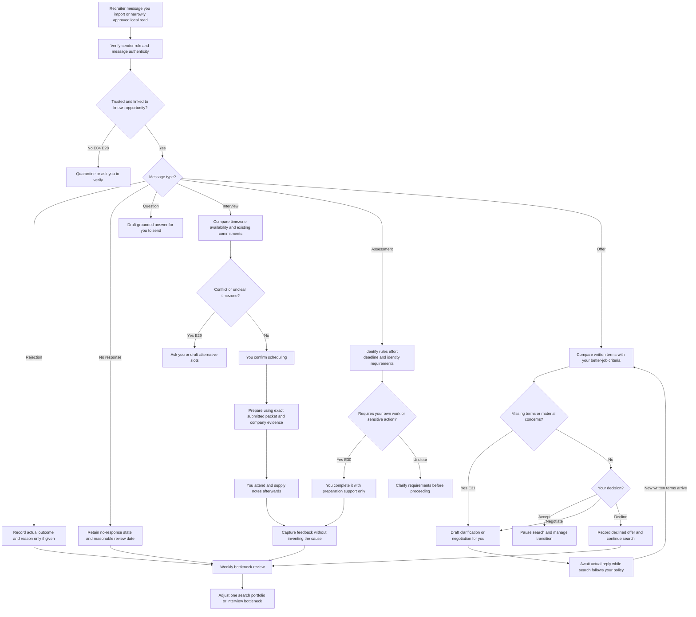

> Proposed workflow, not a deployed feature or completed security assessment. See [current findings](../findings.md) for what the installed baseline actually did.

# Interviews and job decisions

Up: [Start here](../architecture.md).

## Response to better-job decision

The assistant does not accept offers, sign terms, resign, impersonate you in interviews, or fabricate explanations for rejection. It may help prepare, compare options, and draft communication for your review. Legal and contractual uncertainties require appropriate human advice; the system cannot certify an offer.

## Better-job criteria

Agree your priorities before ranking offers: work type and interests, compensation structure, growth, team quality, manager expectations, location/remote restrictions, hours/timezone, stability, notice period, and personal constraints. A higher quoted number is not automatically a better offer; variable pay, equity uncertainty, contractor costs, probation, restrictive terms, and work-country eligibility may change the comparison. Use written evidence and explicit assumptions.

No-response, rejection, interview, offer, accepted, declined, and withdrawn are distinct states. Acceptance is your recorded decision, not an inference from an email. After acceptance, pause applications and visibility suggestions implying availability, cancel outstanding drafts, and let you decide how to notify other employers and your current employer. A later decision to restart is explicit.

## Weekly review

Look separately at discovery quality, packet correctness, your active minutes, meaningful conversations, interview conversion with an adequate observation window, and interview outcomes. Avoid simultaneous strategy changes that make learning impossible. A recurring skill gap may justify a portfolio increment; a broken submission workflow may justify manual applications. The system should stop expanding automation when maintenance exceeds the value it creates.
