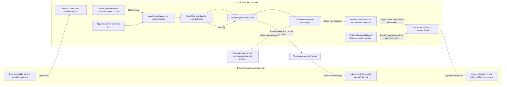
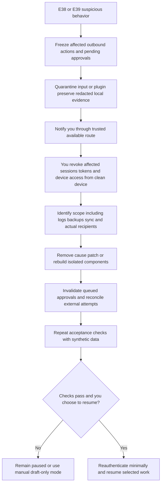

> Proposed workflow, not a deployed feature or completed security assessment. See [current findings](../findings.md) for what the installed baseline actually did.

# Privacy and runtime verdict

Up: [Start here](../architecture.md). This is a recommended security design based on documentation, not an audit of a deployed system. Nothing here guarantees that software, the operating system, or an account cannot be compromised.

## Verdict

**Choose OpenClaw for the constrained pilot.** Use it as a local coordinator with a deliberately small tool interface. Do not give it unrestricted terminal access, personal vault access, or signed-in LinkedIn/X browser access. Model selection is independent and still open.

Both OpenClaw and Hermes document local models, browser tools, messaging, and security controls. Neither is safe merely because it is open-source or runs locally. The recommendation favors the explicit local-model context controls, dedicated browser support, tool policies, and security-audit tooling documented for OpenClaw, together with the already chosen workflow. This is an integration/operational-fit judgment, **not evidence that OpenClaw has fewer vulnerabilities than Hermes**.

| Criterion | OpenClaw | Hermes | Implication here |
| --- | --- | --- | --- |
| Local models | Native Ollama integration; configurable bounded context | Custom local endpoints; current quickstart states 64K minimum context | OpenClaw is the first host-fit experiment; measure the selected model/configuration. |
| Browser capability | Dedicated profile plus optional existing-session access | Local Chromium and optional attached/real profile | Both can act with the signed-in user's authority. Use neither on social-account sessions. |
| Execution controls | Sandbox, allow/deny tools, elevated-exec control, audit commands | Command approval modes, isolated backends, file/MCP controls | Explicit configuration and verification are needed for both. |
| Credential isolation | Documented secret storage and restricted tool/workspace policies | Optional iron-proxy hides certain upstream keys from Docker tool sandboxes | Hermes's proxy is useful but does not protect every host call or solve social-cookie/session misuse. |
| Default assumptions | Sandboxing is off by default; one owner/trust boundary per gateway | Default smart command approval uses an auxiliary LLM; backends and auxiliary providers need review | Do not treat defaults as a private deployment. Remove external auxiliary providers as well as the main cloud model. |

If the OpenClaw configuration cannot pass the acceptance tests below, keep the pilot draft-only. Do not compensate by granting more account access. Hermes is a valid alternative if a measured need justifies switching, but it must pass the same tests; installing both is not a security improvement.

Sources: [OpenClaw local recipes](https://docs.openclaw.ai/providers/ollama/recipes), [sandboxing](https://docs.openclaw.ai/gateway/sandboxing), [tool policy versus elevated execution](https://docs.openclaw.ai/gateway/sandbox-vs-tool-policy-vs-elevated), [Hermes quickstart](https://hermes-agent.nousresearch.com/docs/getting-started/quickstart), [Hermes security](https://hermes-agent.nousresearch.com/docs/user-guide/security), [Hermes iron-proxy limits](https://hermes-agent.nousresearch.com/docs/user-guide/egress/iron-proxy).

## What staying local can and cannot mean

**Recommended interpretation:** private AI inference, candidate facts, drafts, workflow state, and credentials remain on your PC unless you deliberately disclose a reviewed item to a named recipient/device. No cloud LLM, hosted embeddings/reranking, cloud browser, external memory, or sensitive Telegram conversation by default.

Literal zero data leaving the PC is incompatible with online applications, public posting, and reviewing private information on a phone. An employer receives your approved application; LinkedIn/X receive what you manually publish; your authorized phone receives what you view remotely. Web requests expose network/request metadata, and a search provider receives query terms. Use public role/company terms, never a full resume, salary history, or private project data as a search query.

This design supersedes the earlier default of Telegram carrying questions/resumes. The strict default is a private review page over an encrypted private network. Optional third-party notifications would contain only a generic pending-item notice and still disclose service-use metadata; enable them only if you accept that tradeoff. Tailscale states payload traffic is end-to-end encrypted even through its relays, while it handles metadata/control-plane information. Direct self-managed WireGuard is another option if you want to avoid that coordination provider. Neither makes the phone part of the PC. [Tailscale security](https://tailscale.com/security).

## Data and trust-boundary diagram

The boxes represent separate permissions/process boundaries to implement, not guarantees from drawing separate boxes. A prompt alone cannot make the model offline, restrict file access, protect secrets, or enforce approval. A read-only researcher cannot read private evidence, but its output can still contain prompt injection. The writer/model must have no direct outbound path; the separate controller is the only route for approved disclosures.

## Credentials and sessions

- **LinkedIn/X:** no agent credentials or session cookies in the first version. You browse logged in, choose sources, and publish manually. Do not attach your everyday browser or install a relay that grants the agent social-account control. Normal account alerts/manual imports suffice for the initial workflow.
- **Employer application portals:** only where automation is permitted, use a separate browser profile and human login/MFA. A trusted local broker may reuse the resulting session under narrow action rules; the model does not receive passwords/cookies or run arbitrary browser code. Login itself sends credentials to the portal, which is an intentional disclosure. Never copy main-browser cookies or your password-manager vault.
- **Broker limitations:** hiding a password from prompts does not prevent session abuse. Restrict actions, recipient, fields, file paths, and redirects. The model must not call the same authenticated browser directly as an alternative path. Cookies are credentials even if no password was saved.
- **Storage:** use a dedicated OS account/VM as appropriate, restrictive file ownership, full-disk encryption, and protected credential storage supported by the platform/broker. Do not claim secrets are encrypted merely because they are in a config file. OpenClaw documents private data and credentials in its state/config paths; protect those paths and encrypted backups. Browser sessions and logs are sensitive too.
- **Personal separation:** never mount your full home directory, full personal notes vault, unrelated shared notes, SSH keys, `.codex` state, cloud credentials, password manager, or container-engine socket into the worker. Export only the approved career subset; narrow write access to drafts and operational state. A separate OS account helps protect other files from the gateway process as well as its tool sandbox.
- **Mail/calendar:** initial messages are imported by you. Later least-privilege read-only OAuth access, if desired, is a separate explicit grant. Avoid the whole Gmail account or a password/IMAP workaround just to confirm receipts.

LinkedIn's policy prohibits unauthorized scraping/automation; X's policy prohibits non-API browser scripting. A personal login does not grant permission to automate the platform. [LinkedIn policy](https://www.linkedin.com/help/linkedin/answer/a1341387), [X rules](https://help.x.com/en/rules-and-policies/x-automation).

## Required deployment restrictions

1. **Local inference only.** Pin the exact runtime/model; configure every auxiliary function, embeddings, summarizer, vision service, risk reviewer, and fallback. No hosted services by default. Enforce outbound denial for the inference/writer process, not just a localhost URL setting. Model downloads/updates happen in a controlled maintenance phase.
2. **Sandbox every tool-execution session.** Use the documented all-session sandbox mode or stronger isolated worker boundaries; non-main-only sandboxing leaves a gap. Disable elevated execution and deny general shell/process, self-configuration, plugin installation, broad messaging, and unrestricted browser tools. Do not expose the container socket. The host gateway is outside tool sandboxes, so its OS identity and files also need protection.
3. **Use narrowly defined workflow tools.** Read approved evidence, save validated draft, ask question, inspect item status, and request a controlled application action. Permissions must not depend on whether a small model obeys instructions. Do not silently broaden policy when a tool fails.
4. **Constrain outbound traffic at the OS/container/proxy boundary.** Separate public-read and application-action workers. Prevent arbitrary DNS/HTTP, private-network/metadata access, unexpected redirects, and unrelated hosts. Website assets may require reviewed domain additions; failure should cause manual handoff, not unrestricted networking. A browser URL rule is not a complete firewall.
5. **Bind private services privately with authentication.** Do not expose the model, gateway, browser debug ports, or database publicly. A private-network review endpoint still needs authentication, origin/CSRF defenses, device authorization, expiry, and revocation. Keep approval and admin/configuration roles separate; no application-page content can change them.
6. **Pin and inspect dependencies.** Start with built-in necessary capabilities and an explicit plugin allowlist. No opportunistic marketplace skills, unreviewed MCP servers, auto-updates, or self-modifying security policy. Recheck after a reviewed update. A plugin running with gateway authority can bypass model-level restrictions.
7. **Keep private artifacts out of unintended sync.** Review notes sync, cloud backups, Git remotes, telemetry and log exporters. Do not store credentials or operational transcripts in a synced notes vault.

8. **Use minimal retention and protected backups.** Keep needed receipts and exact submitted packets; redact routine logs, truncate untrusted content in diagnostics, and define retention/deletion rules. Backups are another copy of private data and require encryption/access control. Test restore without reviving expired approvals or resending external actions.

Useful operator checks include the documented `openclaw security audit` and `openclaw sandbox explain`. They are diagnostics, not proof that this custom controller/network design is correct. Verify the effective policy on the installed version; this note deliberately does not provide an untested paste-and-run config.

Sources: [OpenClaw security overview](https://docs.openclaw.ai/gateway/security), [one trust boundary per gateway](https://docs.openclaw.ai/gateway/security/trust-model), [secrets and storage](https://docs.openclaw.ai/gateway/security/secrets-and-storage), [browser-control limits](https://docs.openclaw.ai/gateway/security/browser-control), [prompt injection](https://docs.openclaw.ai/gateway/security/prompt-injection).

## Security acceptance checks before real accounts

These are required proposed checks, **not completed tests**:

- Synthetic private marker stays out of network requests, DNS queries, logs exported off-host, crash reports, and external model/search tools. Inspect all participating processes, not just the main LLM call. Test normal and failure/fallback paths; a clean test is limited evidence, not proof of all future behavior.
- Disconnect internet and confirm profile analysis/drafting still works with local dependencies present; online discovery should fail visibly. Reconnect and verify only permitted readers/application workers gain network access.
- An injected job page asking for vault files, a shell command, a new plugin, a changed model endpoint, or an unapproved upload is blocked by permissions even if the model requests it.
- The worker cannot read protected directories, credential stores, browser cookies, another workflow's records, or the whole Obsidian vault. Test the OS account/gateway as well as tool sandbox paths.
- General browser/terminal/API access cannot bypass the final disclosure controller. Opening an arbitrary URL or sending an arbitrary field to an allowed domain is refused.
- Unsupported source/portal, MFA, CAPTCHA, or domain change pauses or hands off. It does not disable certificate checks, bypass access controls, or broaden networking.
- A changed attachment, destination, personal answer, or consent invalidates approval. Unreviewed personal data is not typed into a live page.
- Duplicate phone reply, expired ticket, unauthorized device, and lost-device revocation cannot approve actions.
- Crash after submit produces outcome-unknown and reconciliation, not an automatic resend. Two workers cannot submit the same item concurrently.
- Disk failure or inability to persist the approval/attempt blocks the external action. Backup restoration does not revive old approvals.
- VPN/notification outage retains local queued questions; no sensitive cloud/Telegram fallback occurs.
- Review the pinned version's audit findings, enabled plugins/providers, process permissions, outbound policy, backup/sync destinations, and account/session list before introducing real data.

If a needed boundary cannot be enforced on the chosen host, the safe useful fallback is local analysis and drafts plus manual browsing/application submission. That still removes significant repetitive work without delegating account authority.

## Incident response

Never let an agent investigate a suspected compromise by uploading its full configuration, secrets, or logs to an external support/model service. You own credential changes, account recovery, and any required notices to affected recipients.
