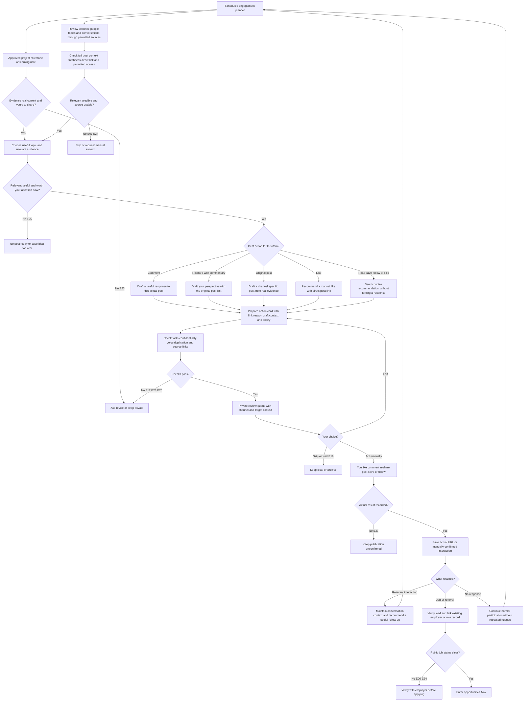

> Proposed workflow, not a deployed feature or completed security assessment. See [current findings](../findings.md) for what the installed baseline actually did.

# LinkedIn and X visibility

Up: [Start here](../architecture.md). Capability checklist: [model requirements](../models.md).

## One evidence source, two audiences

**Clarified scope:** this is a proactive professional engagement assistant, not a feed of application-related activity. It plans regular participation in relevant conversations across LinkedIn and X, including posts by people you follow, selected professional communities, technical discussions, useful questions, and timely debates. Hiring relevance is optional, not a prerequisite. It also drafts original posts when there is something worthwhile to say.

The automation should select specific posts, recommend an action, explain why it is worthwhile, and send the direct post link plus any draft wording. You decide and manually perform comments, original posts, and reshares with your own commentary, editing into your own language as desired. Requested preference: automate a simple like where actually permitted. Current platform rules do not support implementing that preference on X or via unauthorized LinkedIn browser automation, so likes remain one-click manual recommendations in this design.

Build credible visibility alongside real portfolio work. X drafts can be concise observations, a demo, or a specific technical reply. LinkedIn drafts can provide a little more problem/context/result detail, a portfolio highlight, or a relevant professional question. Adapt the presentation without changing the underlying facts. Do not manufacture a professional persona or claim client results that you cannot substantiate.

Initial operations are recommendations and drafts, followed by your manual actions. This requires no LinkedIn or X password, cookie, browser extension, or agent-controlled signed-in session.

## Visibility and relationship flow

## What the planner does for you

Maintain a watchlist of relevant people and topic areas, plus exclusions, language/tone preferences, notification timing, and your attention budget. Start with your actual interests and professional direction; do not infer controversial opinions from a like or invent a stance to attract attention. Suggest new people with sourced reasons and let you accept or dismiss them.

On a schedule, collect available posts through permitted access, deduplicate them, read the post and enough surrounding context, and rank them for relevance, usefulness, recency, whether you can add something specific, and whether the discussion is still active. Prioritize a small actionable digest, not an endless stream. A suggested starting point is three to five items per digest, adjustable after actual use; that is a proposal rather than an agreed daily obligation.

The system performs selection and planning without asking you to write its content calendar every day. It can recommend:

| Suggested action | What you receive |
| --- | --- |
| Like | Direct post link and one sentence explaining why you may want to endorse it. You confirm the actual content before liking. |
| Comment | Direct link, concise context, why responding is worthwhile, and one editable draft that contributes to the discussion. |
| Reshare / quote with commentary | Original post link, suggested angle, editable commentary, and any factual claim needing verification. You perform the reshare manually. |
| Original post | A channel-specific draft grounded in real experience, learning, or evidence, with relevant supporting links. |
| Read / save / follow | Link and reason; do not force a like or comment where reading or saving is more appropriate. |
| Skip | No notification or a short reason in the digest; irrelevant controversy and weak opportunities do not deserve your attention. |

For a hot take, show the author's claim, relevant context, and an evidence-backed response angle. Do not automatically assume you agree. If your stance is unknown, suggest a genuine question or mark the draft's stance for you to choose. Respectful disagreement is useful when you can support it; manufactured outrage, generic flattery, repetitive replies, and unrelated self-promotion are not defaults.

## Action-card contract and feedback

Every actionable recommendation must contain **platform, author, direct original post URL, source/check timestamp, short context, recommended action, why it fits you, editable wording where needed, and a freshness/expiry marker**. A topic suggestion without a specific post link does not satisfy the engagement workflow. Original posts have no target-post URL; label them clearly and include evidence links instead. Do not invent or substitute a profile/search link for an unavailable post link.

You can open the link, copy/edit the draft, mark done, skip, ask for a different angle, mute the topic/person, or snooze the item. Opening a link is not proof that you liked or posted. Keep recommended, opened, done-reported, confirmed, skipped, and expired distinct. Track the post/action pair to avoid recommending the same like/comment repeatedly. A deleted post, changed context, exhausted attention budget, or stale draft gets rechecked or withdrawn before another recommendation.

Use your edits and explicit feedback to improve tone and relevance. Avoid repeatedly pitching your portfolio in every reply. Useful conversations remain useful even if no job lead emerges; jobs/referrals branch into the application flow only when they actually appear. Review whether the digest saves time and leads to interactions you value, not whether it merely drives activity volume.

## How posts become available

Proactive planning requires a usable, permitted reading source. At setup, verify actual official API/partner access and available fields for each platform. Do not assume that a LinkedIn home feed, all followed-account posts, or the full X timeline is available through an API. Coverage may be limited and can differ by account, permission, plan, or source. No feed integration has been configured or tested yet.

Where automated retrieval is not authorized or unavailable, use platform alerts, user-supplied post links/excerpts, or appropriately permitted exports/sources. The assistant still ranks, plans, drafts, and tracks those items automatically, but it must label limited coverage rather than claim it reviewed your entire feed. Logging a general browser agent into your account is not a workaround for missing API permission. No new credentials or account-control authority is granted by this design update.

## People to follow and profile upkeep

For each proposed contact, show public source/date, company/role where known, why relevant to your work or interests, evidence of hiring relevance only if any, and one useful next action. People need not be recruiters or currently hiring to be worth following. Following a person does not mean they are hiring or that you have a relationship. Do not infer private email addresses or collect unrelated personal details.

Suggest profile headline/About/project changes from approved facts. You apply them manually. Public job-seeking signals, current-employer visibility, salary details, and portfolio publication are deliberate choices for you. The assistant must not automatically announce that you are leaving your job. Keep public profile changes on hold if you have not approved the visibility policy.

For portfolio work: identify a real evidence gap, suggest the smallest demonstrable improvement, capture completion evidence, then draft a useful post. An unfinished portfolio need not prevent sharing truthful learning or a bounded demo. A broken demo link should be repaired or removed from a draft; do not call it live until checked.

## Platform boundaries

LinkedIn prohibits unauthorized scraping and automated activity. X prohibits non-API website scripting and restricts automated engagement. Use normal platform alerts, your supplied links/excerpts, permitted public sources, and specifically authorized official APIs if available. Public visibility of a page does not itself grant scraping permission. Search-service terms and platform content-use restrictions still matter. If access is blocked or requires authenticated scraping, use manual input instead of circumvention.

**Likes:** X explicitly prohibits automated likes. LinkedIn prohibits unauthorized automated activity, including likes. Thus neither a browser script nor possession of an API endpoint or personal credentials is enough to enable this action. Keep likes manual under the current design. Any future explicitly permitted platform-specific integration would need verification of that exact permission and a separately restricted connector; it is not enabled now.

No bulk auto-follow, auto-connect, unsolicited automated replies, or mass DMs. Comments, original posts, and reshares with commentary stay manual by your preference. Social content is drafted locally and published by you in your normal browser. Later approved API publishing would be a separate design and authorization decision, not a permission implied by this workflow.

Sources: [LinkedIn prohibited software](https://www.linkedin.com/help/linkedin/answer/a1341387), [X automation rules](https://help.x.com/en/rules-and-policies/x-automation).

## Feedback

Prefer useful exchanges, knowledge gained, ongoing professional relationships, and consistent participation you actually value. Relevant profile/portfolio visits, referrals, and interviews are downstream benefits when actually measurable, not the sole reason to recommend a post. A portfolio visit is not proof of hiring intent. Negative reactions, factual corrections, or accidental private disclosure go to E26/E39 and stop further related publishing suggestions until reviewed. One useful post can be adapted across platforms, but avoid repeated identical replies or posting just to fill a quota.
