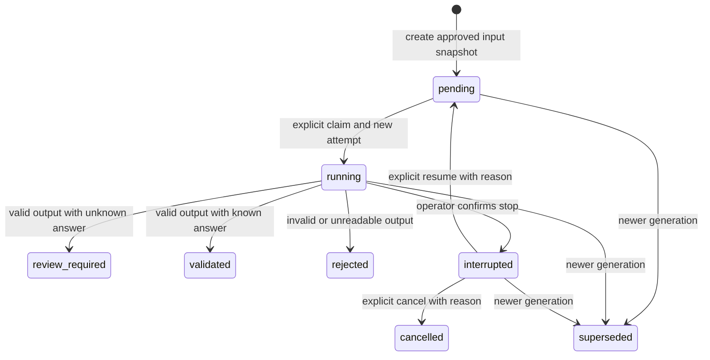

# Run isolation and explicit recovery

Verified on the Omarchy PC through visible Cmux SSH on 15 November 2026.
This host-side controller combines the skill-match validator with a persistent
run ledger. It does not start a model, browser, worker, account action or daemon.

## What changed

Each logical job gets a monotonically increasing generation and a random run ID.
Claiming pending work creates a random attempt ID and a separate worker directory:

    ~/career-ai/workspace/runs/RUN_ID/ATTEMPT_ID/

request.json contains minimal copied context and result.json is the only accepted
output location. request.json is worker-visible guidance, not trusted authority.
The approved input bytes and their hashes were already snapshotted in the private
ledger when the run was created. Editing the request or original input files does
not change those snapshots. To change approved facts, create a new run generation.

The ledger defaults to ~/career-ai/workflow-state/ledger.sqlite3, outside the agent
workspace. A completed result is a bounded raw-byte snapshot plus its deterministic
validation report, stored in the same transaction as the final status. Later edits
to result.json cannot change the committed snapshot. Duplicate completion is refused.

A newer generation becomes current immediately. An older result remains historical
but cannot become the current job result, even if it arrives late. A newly current
pending/rejected run does not fall back to an older validated one.

## State transitions

validated means that the four-field skill-match contract passed, not that an
application is approved. action_authorized is always false in every CLI decision.
External submission idempotency and human approval remain separate unbuilt work.

## Operator commands

Run from the repository root. Defaults match the published workspace configuration.
Use --state-root and --workspace before the subcommand only for a reviewed alternate
layout. State must remain outside the worker workspace; a ledger is bound to that
workspace and refuses an unrelated, empty, corrupt or unsupported existing database.

Create from trusted files outside the worker workspace:

    python3 -m workflow create --job synthetic-role \
      --candidate examples/candidate.synthetic.json \
      --requirements examples/requirements.synthetic.json

Copy the printed run_id into the next command:

    python3 -m workflow claim RUN_ID

Claim returns the request/output paths and attempt_id; it does not launch a worker.
The trusted operator/adapter must pass the attempt-specific context and exact output
path to the worker. After the worker finishes, ingest its output:

    python3 -m workflow complete RUN_ID --attempt ATTEMPT_ID
    python3 -m workflow status RUN_ID
    python3 -m workflow current synthetic-role
    python3 -m workflow events RUN_ID

Only the currently claimed attempt can complete, and only once. Unknown work
information still requires review. Bad output returns rejected and is retained
when it is a readable bounded file. Oversize, missing, symlinked or special output
is rejected without following it or reading an unbounded payload. Parent-directory
symlinks are also refused through descriptor-relative directory traversal.

## Interruption and restart

Reopening the controller never claims or resumes running work. A stored running
state means an outstanding claim, not proof that a process is alive or dead.
Confirm the old worker stopped before recording interruption:

    python3 -m workflow interrupt RUN_ID --attempt ATTEMPT_ID \
      --reason 'Operator verified the old worker stopped'
    python3 -m workflow recover RUN_ID --decision resume \
      --reason 'Operator reviewed the saved inputs and wants a fresh attempt'
    python3 -m workflow claim RUN_ID

Resume returns the run to pending. The separate claim creates a fresh attempt and
path; it never reuses the old output. Late completion from the earlier attempt is
refused. Repeated resume decisions and recovery of superseded runs are refused.
For cancellation, use recover with --decision cancel and a nonempty reason; that
run then cannot be claimed or resumed. Recovery reasons are audit records, not
cryptographic evidence of a person's identity or consent.

Exit codes: 0 = requested operation recorded; 2 = rejected transition/input/result;
1 = storage unavailable. Any success still has action_authorized=false. Do not
wire exit code 0 directly to submitting forms or posting messages.

## Verified evidence

17 new recovery tests passed alongside 33 existing tests (50 total). They cover
competing claims, both saved incorrect model outputs, overwritten worker files,
late generations, stale attempt IDs, cancellation/replayed recovery, mutable input
files, symlink/size limits, corrupt or unrelated databases and private permissions.
A child process exited abruptly after committing its claim: reopening preserved
running and required an explicit recovery decision. Another child died inside an
uncommitted SQLite transaction; reopening rolled it back. A forced audit-write
failure rolled back result/status changes together.

Separate CLI processes demonstrated stale-run rejection, blocked duplicate
completion, accepted snapshot preservation, explicit resume with a new path,
old-attempt rejection, cancellation and replay of the actual saved omission.
See examples/results/run-recovery-checkpoint.json. All fixtures were synthetic;
no model, gateway, browser or account was started by these checks.

## Boundaries and remaining integration

- The worker directories are writable scratch space. Only committed ledger
  snapshots are authoritative; do not poll a shared worker file as an approved result.
- SQLite transactions, private permissions and append-only result/event triggers
  protect application behavior and accidental updates. The same OS owner or a
  compromised host gateway can still tamper with files/database settings. This is
  not encrypted storage, a separate OS account or a tamper-proof audit system.
- Attempt IDs are stale-work fences, not secrets or authenticated user identities.
- Claim/export failure can leave an unreferenced directory; it is never reused.
  Inspect it before any manual cleanup. Do not delete or reset an existing ledger
  to suppress an integrity/version error.
- This does not patch OpenClaw's native automatic session recovery. A future
  adapter must use unique sessions/attempt paths and invoke completion with the
  correct attempt after the worker stops. Legacy shared-path workflows remain unsafe.
- The controller does not terminate processes or detect their death automatically.
  No timers, scheduler, lease expiry or automatic retries are added.
- A model-driven synthetic end-to-end test remains to be integrated. No live
  application or social workflow is authorized by this ledger.
- Abrupt process-exit tests do not prove behavior under physical power loss or
  filesystem/hardware failure. Backup restoration can revive old state; keep
  restored ledgers offline for review and invalidate outstanding work before use.
- The database contains trusted input snapshots and retained model output. Keep
  it and its journals/backups private, out of Git and notes sync. Export only
  deliberately sanitized summaries.

Follow-up: the synthetic embedded model-worker adapter is now verified; see [model-worker.md](model-worker.md). Earlier offline-only statements describe the original controller increment. Native recovery and external-action authority remain unchanged.
